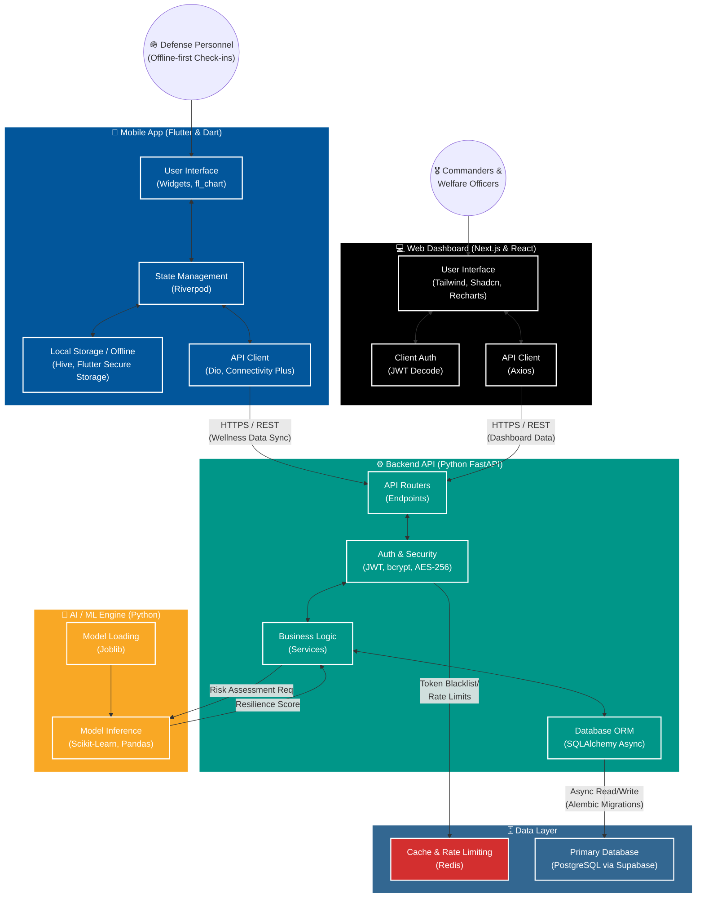

# SainikSaathi Architecture & Data Flow

This document provides a comprehensive view of the SainikSaathi ecosystem, outlining the various components, their tech stacks, and how data flows through the system.

## Full System Flow Diagram

## Component & Tech Stack Breakdown

### 1. Mobile App (Frontend for Personnel)
*   **Role:** Primary data collection point. Allows defense personnel to submit daily wellness check-ins (mood, sleep, fatigue, focus).
*   **Tech Stack:**
    *   **Framework:** Flutter & Dart (Cross-platform iOS/Android)
    *   **State Management:** Riverpod (`flutter_riverpod`)
    *   **Networking:** Dio (`dio`)
    *   **Offline/Local Storage:** Hive (`hive_flutter`) for offline-first queueing, Flutter Secure Storage for sensitive local data (tokens).
    *   **UI/Visuals:** `fl_chart` for wellness trends, `google_fonts`, `cupertino_icons`.
*   **Flow:** The app operates offline-first. Personnel submit data, which is stored locally via Hive. When internet connectivity is restored (detected via `connectivity_plus`), Dio securely transmits the data to the Backend API.

### 2. Web Dashboard (Frontend for Command)
*   **Role:** Portal for Commanders and Welfare Officers to view aggregated wellness data, triage lists, and actionable interventions.
*   **Tech Stack:**
    *   **Framework:** Next.js (React)
    *   **Styling & UI Components:** Tailwind CSS, Shadcn UI (`@base-ui/react`, `lucide-react`)
    *   **Networking:** Axios (`axios`)
    *   **Data Visualization:** Recharts (`recharts`)
*   **Flow:** The web dashboard securely authenticates the Commander/Officer and uses Axios to fetch aggregated unit data and triage lists generated by the AI Engine via the Backend API.

### 3. Backend API (Core Server)
*   **Role:** The central nervous system of the platform. Validates data, handles authentication, routes data to the database, and triggers AI analysis.
*   **Tech Stack:**
    *   **Framework:** Python FastAPI
    *   **Server:** Uvicorn
    *   **Security:** `python-jose` for JWT, `bcrypt` for password hashing, `cryptography` for AES-256 encryption of sensitive notes.
    *   **Validation:** Pydantic
*   **Flow:** Receives encrypted HTTPS requests. Validates JWT tokens against Redis (for blacklisting) and checks rate limits. Processes requests through service layers and hands data off to the Database or AI Engine.

### 4. Database & Caching (Data Layer)
*   **Role:** Persistent and secure storage of sensitive military health data, alongside fast-access caching.
*   **Tech Stack:**
    *   **Relational DB:** PostgreSQL (hosted via Supabase)
    *   **ORM & Migrations:** SQLAlchemy (`asyncpg`) and Alembic
    *   **Cache:** Redis (`redis[asyncio]`)
*   **Flow:** SQLAlchemy asynchronously handles all reads/writes to Postgres. Redis is utilized by the backend for quick-access operations like rate-limiting and managing invalidated auth tokens.

### 5. AI / ML Engine (Predictive Analytics)
*   **Role:** Analyzes wellness check-ins and HR metrics to calculate a *Resilience Score* and classify personnel risk levels (*Routine*, *Monitor*, *Intervention Recommended*).
*   **Tech Stack:**
    *   **Data Processing:** Pandas, Numpy
    *   **Machine Learning:** Scikit-Learn
    *   **Model Management:** Joblib
*   **Flow:** When new wellness data is ingested by the backend, the AI services load pre-trained models via Joblib, process the input data using Pandas/Numpy, and use Scikit-Learn to output the classification. The result is saved back to Postgres.

### 6. Infrastructure & Deployment
*   **Role:** Containerization and consistent environments.
*   **Tech Stack:** Docker & Docker Compose
*   **Flow:** The entire backend ecosystem (FastAPI, Redis, ML Engine) is containerized using Docker, allowing for secure, isolated, and scalable deployment in defense-grade cloud environments.
